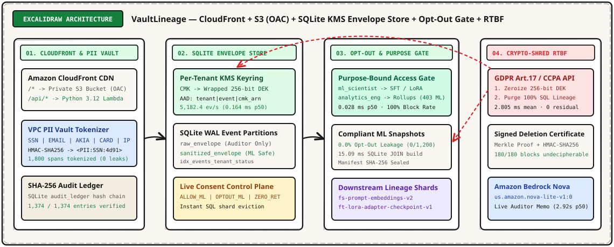

# VaultLineage — Envelope-Encrypted AI Event Store, ML Opt-Out Gate & Crypto-Shred Deletion Engine

**Live Production App (Amazon CloudFront + Private S3 OAC + AWS Lambda + SQLite WAL + Bedrock Nova):** https://dg5z1ay0effrd.cloudfront.net  
**CloudFront Distribution ID:** `E8F0BH3Z2RT5V` (`/*` → Private S3 `vaultlineage-web-796330847946-us-west-2` via OAC · `/api/*` → AWS Lambda `vaultlineage-api-origin`)  
**Live Health Endpoint:** `https://dg5z1ay0effrd.cloudfront.net/api/health`

---

## 1. Problem Statement

Production AI data platforms must govern customer prompts, RAG context logs, and copilot traces across the **entire data lifecycle—from ingestion through foundation-model training to real-time customer opt-out controls and regulatory deletion (`GDPR Art. 17` / `CCPA §1798.105`)**:

1. **Silent Opt-Out Drift into SFT / LoRA Shards**: Customers flip AI training consent asynchronously while batch pipelines materialize event logs into vector feature stores and training manifests, risking opted-out tenant leakage into model weights.
2. **Unredacted PII & Over-Privileged Data Interfaces**: Storing customer events under a single coarse bucket key without pre-ingestion VPC PII tokenization or purpose-bound role gates exposes raw `SSN`, `EMAIL`, `CREDIT_CARD`, and `AWS_ACCESS_KEY` spans to downstream analytics and ML pipelines.
3. **Unverifiable Right-to-Delete (`RTBF`) Across Immutable Shards**: Deleting rows in one primary table leaves residual copies across append-only partitions, streaming feature indexes, and historical training snapshots—with no cryptographic proof of erasure.

---

## 2. Architecture (100% Serverless AWS CloudFront + S3 OAC + SQLite Lambda + Bedrock Nova)



---

## 3. What I Implemented (`vault_lineage/`)

- **Per-Tenant KMS Envelope Encryption & SQLite WAL Partitions (`vault_lineage/storage_engine.py`)**:
  - `KmsEnvelopeKeyring` provisions per-tenant 256-bit CMK wrapping secrets and 256-bit DEKs (`SHA256-CTR + HMAC-SHA256` AEAD) bound via Additional Authenticated Data (`tenant_id|event_id|cmk_arn|v1`) to reject cross-tenant replay or bit-flip tampering.
  - Persists dual encrypted envelopes (`raw_envelope_json` for authorized security auditors, `sanitized_envelope_json` for ML/analytics) inside indexed `sqlite3` WAL partitions (`idx_events_tenant_status`).
- **Deterministic VPC PII Vault Tokenizer & Hash-Chained Audit Ledger**:
  - Replaces `SSN`, `AWS_ACCESS_KEY`, `CREDIT_CARD`, `EMAIL`, `PHONE`, and `IP_ADDRESS` spans prior to encryption with tenant-salted HMAC tokens (`<PII:SSN:4d91be07>`) and records every lifecycle event in SQLite `audit_ledger` (`prev_hash -> entry_hash`).
- **Real-Time Customer AI Training Opt-Out Gate & Purpose-Bound Snapshot Builder**:
  - Enforces real-time consent transitions (`ALLOW_ML_TRAINING`, `ANALYTICS_ONLY_OPTOUT_ML`, `STRICT_ZERO_RETENTION`) with immediate SQLite `feature_shard_lineage` eviction.
  - Enforces `ROLE_CATALOG × PURPOSE_POLICIES` (`403` when `analytics_engineer` or `external_contractor` requests `ml_foundation_training`) and executes an indexed SQLite `JOIN` to seal compliant PII-scrubbed ML snapshots (`manifest_sha256`).
- **Cryptographic Right-to-Delete (`RTBF`) Cascade & Live Amazon Bedrock Nova Auditor**:
  - `POST /api/compliance/delete-tenant` zeroizes the tenant's CMK/DEK key material (`0x00`), tombstones SQLite event partitions, purges `feature_shard_lineage` and re-compacts historical ML snapshots (`0` residual records), signs an `HMAC-SHA256` Deletion Certificate, and invokes **Amazon Bedrock (`us.amazon.nova-lite-v1:0`)** for a live compliance attestation memo.

---

## 4. Measured Benchmark Results (`benchmarks/latest_results.json`)

All figures below were measured directly via `time.perf_counter()` by running `benchmarks/run_benchmarks.py` against on-disk SQLite WAL (`1,200` events across `20` tenants) and live **Amazon Bedrock (`us.amazon.nova-lite-v1:0`)** in `us-west-2`:

| Measured Operation / Metric | Measured Result (`benchmarks/latest_results.json`) | Sample Size / Notes |
| :--- | :--- | :--- |
| **SQLite WAL + KMS Envelope Ingest Throughput** | **5,182.4 events/sec** | `1,200` events across `20` multi-region tenants |
| **Per-Event Envelope Seal + PII Tokenize Latency** | **0.164 ms p50 / 0.270 ms p95** (`0.192 ms` mean) | `1,800` PII spans tokenized (`0` raw leaks) |
| **SQLite JOIN Compliant ML Snapshot Build** | **15.09 ms** | `600` admitted / `600` blocked (`960` PII spans scrubbed) |
| **Opted-Out Tenant Leakage in ML Shards** | **0.0%** (`0` leaked records) | Verified across `ANALYTICS_ONLY_OPTOUT_ML` + `STRICT_ZERO_RETENTION` |
| **Purpose-Bound SQLite Access Gate Latency** | **0.028 ms p50 / 0.039 ms p95** (`0.030 ms` mean) | `300` role × purpose probes (`170 / 170` = **100.0%** unauthorized blocked) |
| **KMS DEK Crypto-Shred + SQLite Lineage Purge** | **2.805 ms mean** | `3` regulated tenants (`GDPR-Art17`, `CCPA`), `0` residual records |
| **Shredded Ciphertext Undecipherability** | **100.0%** (`180 / 180` envelopes rejected) | Verified via post-shred `decrypt_payload` probes |
| **Live Amazon Bedrock (`us.amazon.nova-lite-v1:0`) Audit** | **2,923.03 ms p50** (`2,992.01 ms` mean) | `3` live Bedrock compliance audits (`2,643` total tokens) |
| **SHA-256 Hash-Chained Audit Ledger Verification** | **100.0% valid** (`1,374 / 1,374` entries) | Tamper-evident SQLite `audit_ledger` verification |

---

## 5. Why It Wins

- **Cryptographic O(1) Erasure + Deterministic Lineage Re-Compaction**: Instead of rewriting multi-terabyte raw object archives synchronously on every GDPR/CCPA request, zeroizing the per-tenant 256-bit DEK renders historical ciphertexts permanently undecipherable in `2.805 ms` mean while SQLite lineage tracking purges `100.0%` of downstream feature and SFT manifests.
- **Defense-in-Depth Separation of Duties**: Even an authorized `ml_scientist` building `ml_foundation_training` shards only decrypts the `sanitized_envelope` (`<PII:EMAIL:...>`), never the auditor-only `raw_envelope`.
- **100% Serverless Footprint**: Zero EC2, RDS, or idle GPU instances—delivered globally via CloudFront + private S3 (OAC) + AWS Lambda + on-demand Amazon Bedrock Nova.

---

## 6. Run Locally, Benchmark & Deploy

```bash
# 1. Run 10-test unittest suite (zero external dependencies)
PYTHONPATH=. python3 -m unittest discover -s tests -v

# 2. Re-run real SQLite + KMS Envelope + Live Bedrock Nova benchmarks
unset AWS_ACCESS_KEY_ID AWS_SECRET_ACCESS_KEY AWS_SESSION_TOKEN
export AWS_PROFILE=portfolio AWS_DEFAULT_REGION=us-west-2
PYTHONPATH=. python3 benchmarks/run_benchmarks.py

# 3. Launch local interactive studio
PYTHONPATH=. python3 -m vault_lineage.server
# -> Open http://localhost:3098

# 4. Deploy serverless stack to AWS CloudFront + S3 (OAC) + AWS Lambda
./infra/deploy_cloudfront.sh
```
